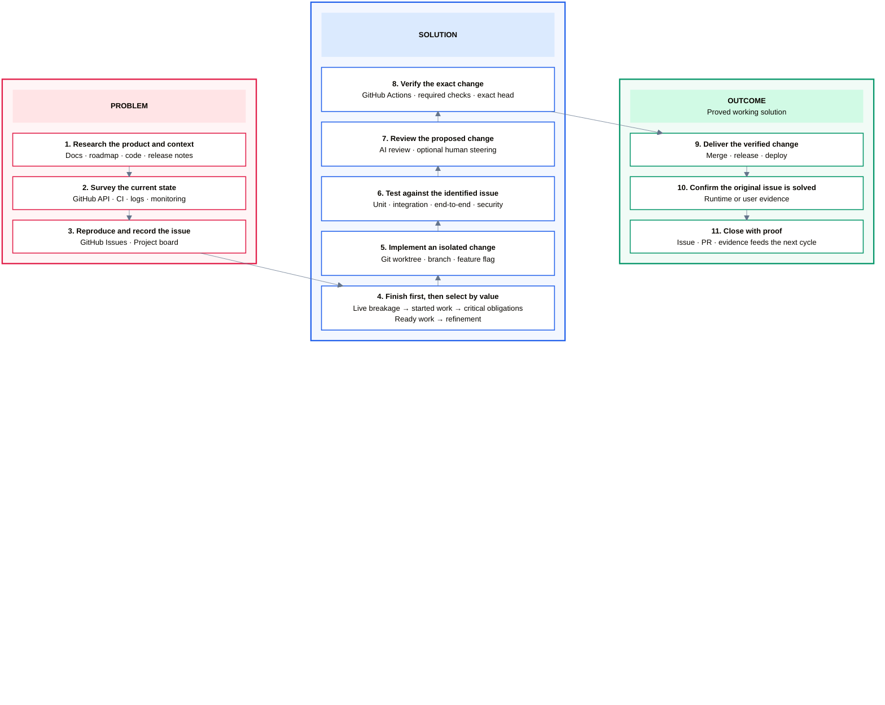

Getting an AI agent to write code is the easy part. The difficult part is making sure it works on the right problem, changes the right thing, and produces evidence strong enough to call the result complete.

I use a scheduled **Agentic Engineer** across the Devantler Tech portfolio. It keeps products healthy, moves their roadmaps forward, and works through GitHub Issues and pull requests like another engineer would. The process is designed around one distinction: activity is not an outcome.

An open pull request is activity. Green CI is useful evidence. The outcome is a working solution that resolves the problem that started the work.

This post shows [the process](#the-process) step by step and explains why I structured the loop this way.

## The unit of work is a proved outcome

Autonomous agents are naturally rewarded by visible output: a commit, an issue, a pull request, or a comment. Those artifacts are useful, but they can also create the appearance of progress without changing the product for the better.

I therefore frame the work in three categories:

1. **Problem** — research the product, survey its current state, and identify a reproducible issue.
2. **Solution** — select an actionable task, implement it, test it, review it, and verify the exact proposed change.
3. **Outcome** — deliver the change, confirm the behavior, and close the issue with evidence.

The categories are containers. The numbered activities are the actual process.

## The process

Read the numbered arrows down **Problem**, upward through **Solution**, and then down **Outcome**. The outer boxes only categorize the work; the activities form the actual sequence.

## Problem means discovery work

In this model, “Problem” is not a vague pain statement at the left side of a slide. It is a sequence of engineering activities.

The agent first reads the product's documentation, roadmap, code, and release history. It then surveys present state through the GitHub API, CI, logs, monitoring, open pull requests, and existing ownership claims. Only then does it reproduce and record an issue.

That ordering matters. Without it, an agent can fix a symptom that another change already addresses, open a duplicate issue, or select work that is blocked by a dependency it never inspected.

GitHub Issues and the portfolio Project board are not the source of truth for whether the product works. They are the durable surfaces where a researched problem, its priority, and its ownership become visible.

## Solution starts with selection, not code

The agent first addresses live breakage, then finishes work already started, including open pull requests and due verification. Critical obligations come next, followed by value-prioritized Ready work and refinement. An ordinary bug or security label does not make a task urgent. New work is chosen for its outcome, risk and cost of waiting within available delivery capacity; age breaks comparable ties and helps identify neglected work. The agent never descends while a higher rung still has actionable work, and it checks whether another engineer already owns the same artifact.

Implementation happens in an isolated Git worktree and branch. That is essential when multiple agents work concurrently: isolation is what turns parallelism from a race into separate, reviewable changes.

Testing is tied back to the issue. A focused regression test proves the reported failure has changed; the repository's wider unit, integration, end-to-end, lint, and security checks look for collateral damage.

The change then moves through a draft pull request, required AI review, optional human steering, and GitHub Actions. Draft status is useful because it exposes the work without claiming readiness.

## Verification belongs to the exact change

One of the most important details is also one of the easiest to lose: evidence belongs to a specific commit.

If a review examined commit A and the branch now points at commit B, the review is historical evidence. The same is true for tests and security checks. My process re-reads the current pull-request head and verifies that the checks, reviews, and merge decision all refer to that exact change.

This prevents a common failure mode where an agent fixes one finding, pushes a new commit, and then treats the previous green state as if it automatically covered the new code.

## Outcome requires delivery and confirmation

A merged change may still fail to solve the product problem. Configuration can be accepted by CI but rejected by a live control plane. A release can complete while the user-facing behavior remains broken. A static change can be correct without proving that a runtime recovered.

The outcome stage therefore has three activities:

1. Deliver the verified change through the normal merge, release, or deployment path.
2. Confirm the original issue using runtime, user, or other product-level evidence.
3. Record that proof on the issue and pull request before closing the work.

The required evidence depends on the change. Static documentation does not need production telemetry. A runtime-sensitive fix does. When the needed deployment fact is unavailable, the honest state is incomplete—not “probably working.”

## Tools have separate responsibilities

The process works because no single tool is asked to prove everything.

- **Documentation, roadmaps, code, and release notes** establish intent and context.
- **GitHub Issues and Projects** make researched problems, priorities, and ownership durable.
- **Worktrees and branches** isolate implementation.
- **Pull requests and reviews** expose the exact proposed change to judgment.
- **GitHub Actions** provides deterministic build, test, lint, and security evidence.
- **Runtime and user signals** establish whether delivery produced the intended behavior.

Separating those responsibilities also makes missing evidence visible. Green CI cannot silently substitute for runtime verification, and an open issue cannot substitute for a reproduced problem.

## The trade-off is deliberate friction

This process is slower than asking an agent to generate a patch and merge it immediately. It spends time on research, ownership checks, isolated work, review, and evidence collection.

That friction is intentional. It reduces duplicate work, stale approvals, unsafe concurrency, and changes that are technically green but operationally unproved. It also makes the stopping point clearer: the work ends when the solution is proved, not when the agent runs out of actions to take.

The loop then begins again. Evidence from the completed issue becomes context for the next survey, and the portfolio's live state determines what deserves attention next.

## Explore the implementation

The portable role and procedures live in the open-source <a href="https://github.com/devantler-tech/agent-plugins/tree/main/plugins/agentic-engineering">Agentic Engineering plugin</a>. The deployment-specific portfolio contract is visible in the monorepo's [AGENTS.md](https://github.com/devantler-tech/monorepo/blob/main/AGENTS.md).

If you are building a similar workflow, start by defining what evidence closes the loop for your product. The agent, model, and scheduler matter, but the definition of a proved outcome matters more.
